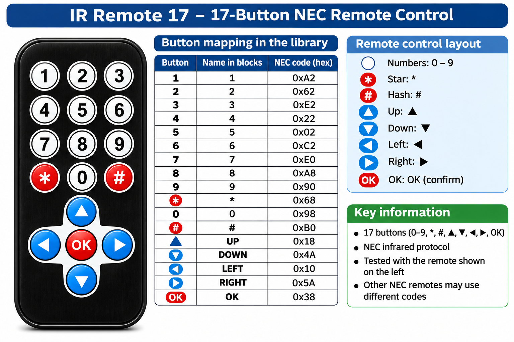

[README.md](https://github.com/user-attachments/files/35019692/README.md)
# IR Remote 17 for BBC micro:bit V2

An independent Microsoft MakeCode extension for a **17-button NEC infrared remote control**. It supports button press, release, and long-press events without requiring the MakerBit extension.



> **Compatibility:** The remote's appearance alone does not guarantee compatibility. This extension uses the NEC command codes listed below. Other visually similar remotes may transmit different codes.

## Features

- Independent NEC IR decoder (no external IR extension required)
- 17 buttons: `0`–`9`, `*`, `#`, `UP`, `DOWN`, `LEFT`, `RIGHT`, and `OK`
- Configurable digital receiver pin (examples use `P15`)
- Press, release, and long-press events
- Configurable long-press duration and release timeout
- Read the current or last received command
- MakeCode Blocks and JavaScript support

## Hardware and wiring

You need a BBC micro:bit V2, a compatible NEC 17-button IR remote, and a **3.3 V-compatible demodulating IR receiver** (typically 38 kHz).

| IR receiver | micro:bit V2 |
| --- | --- |
| VCC | 3V |
| GND | GND |
| OUT / SIGNAL | P15 |

Check the pinout and supply-voltage requirements of your specific receiver before connecting it. The input pin can be changed in the initialization block.

## Installation

1. Open [Microsoft MakeCode for micro:bit](https://makecode.microbit.org/).
2. Create or open a project.
3. Select **Extensions**.
4. Search for `https://github.com/pawelkasprowicz/pxt-ir-remote-17`.
5. Add **IR Remote 17** to the project.

## Quick start

```typescript
irremote.init(DigitalPin.P15)

irremote.onPressed(irremote.Button.B1, function () {
    basic.showNumber(1)
})

irremote.onPressed(irremote.Button.OK, function () {
    basic.showIcon(IconNames.Yes)
})
```

## MakeCode blocks and JavaScript API

### Receiver

`IR uruchom odbiornik na pinie [P15]` — initialize the receiver once.

```typescript
irremote.init(DigitalPin.P15)
```

### Button events

| Block (Polish) | JavaScript | Behavior |
| --- | --- | --- |
| `IR po naciśnięciu [1]` | `irremote.onPressed(button, handler)` | Fires once when a new button press is detected |
| `IR po zwolnieniu [1]` | `irremote.onReleased(button, handler)` | Fires after the signal has timed out |
| `IR po przytrzymaniu [1]` | `irremote.onHeld(button, handler)` | Fires once after the configured hold time |

```typescript
irremote.init(DigitalPin.P15)
irremote.setHoldTime(1000)
irremote.setReleaseTimeout(220)

irremote.onPressed(irremote.Button.OK, function () {
    serial.writeLine("OK: PRESSED")
})

irremote.onHeld(irremote.Button.OK, function () {
    serial.writeLine("OK: HELD")
})

irremote.onReleased(irremote.Button.OK, function () {
    serial.writeLine("OK: RELEASED")
})
```

### Settings

| Block | JavaScript | Default |
| --- | --- | --- |
| Hold duration | `irremote.setHoldTime(1000)` | 1000 ms |
| Release timeout | `irremote.setReleaseTimeout(220)` | 220 ms |

The release event is inferred from the absence of IR transmissions. It is therefore delayed by approximately the configured timeout. Long-press detection relies on repeat frames from the remote.

### Reading button state

```typescript
// True while the selected button is considered held.
let pressed = irremote.isPressed(irremote.Button.Up)

// Last decoded command, or -1 before the first valid command.
let lastCode = irremote.last()

// Currently active command, or -1 when none is active.
let activeCode = irremote.current()

// Reset the stored last command.
irremote.clear()
```

`last()` and `current()` return the **8-bit NEC command value**, not the full 32-bit IR frame.

## Verified NEC codes

The following command values were measured using the pictured remote:

| Button | NEC command | Full NEC frame |
| --- | --- | --- |
| 1 | `0xA2` | `0x00FFA25D` |
| 2 | `0x62` | `0x00FF629D` |
| 3 | `0xE2` | `0x00FFE21D` |
| 4 | `0x22` | `0x00FF22DD` |
| 5 | `0x02` | `0x00FF02FD` |
| 6 | `0xC2` | `0x00FFC23D` |
| 7 | `0xE0` | `0x00FFE01F` |
| 8 | `0xA8` | `0x00FFA857` |
| 9 | `0x90` | `0x00FF906F` |
| * | `0x68` | `0x00FF6897` |
| 0 | `0x98` | `0x00FF9867` |
| # | `0xB0` | `0x00FFB04F` |
| UP | `0x18` | `0x00FF18E7` |
| DOWN | `0x4A` | `0x00FF4AB5` |
| LEFT | `0x10` | `0x00FF10EF` |
| RIGHT | `0x5A` | `0x00FF5AA5` |
| OK | `0x38` | `0x00FF38C7` |

## Testing

The 17 command values were verified on BBC micro:bit V2 with the receiver connected to P15. A 10-second continuous press of **OK** produced one press, one hold, and one release event in the test performed.

## Notes

- Call `irremote.init(...)` only once per program.
- The current implementation supports one initialized receiver.
- The release and hold behavior depends on the timing of the IR remote's NEC repeat frames.
- Other remotes using NEC may require a different command mapping.

## License

Add an MIT `LICENSE` file to the GitHub repository if you intend to publish this extension under the MIT license.
